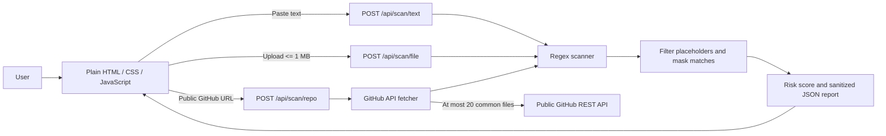

# LeakLens

An Env File Leak Scanner that helps identify potentially exposed secrets in text, files, and public GitHub repositories.

## Features

- Paste text, upload a supported file, or scan a public GitHub repository.
- Detect AWS, GitHub, Stripe, Google, Slack, JWT, private-key, database URL, and generic assigned secrets.
- Skip common placeholders and show only masked secret previews.
- View a weighted risk score, severity counts, and remediation guidance.
- Download a sanitized JSON report.
- Scans run in memory; source content and full secret values are not stored or returned.

## Tech stack

- Python 3.10+
- FastAPI, Pydantic, httpx
- Plain HTML, CSS, and JavaScript
- pytest

## System architecture



The FastAPI application serves the static frontend and scan endpoints. Text and uploaded files are scanned in memory. Repository scans use the GitHub REST API to retrieve matching files from public repositories. The scanner returns findings with masked previews, severity, and remediation suggestions; source content and full matches are not persisted.

## System workflow

1. The user chooses pasted text, a local file, or a public GitHub repository URL.
2. The API validates the request. Uploads are restricted to supported text extensions and a 1 MB maximum. GitHub URLs must point to a public repository.
3. For repository scans, LeakLens lists the repository tree and fetches at most 20 matching common configuration files.
4. The scanner checks each line against the detector patterns and skips obvious placeholders.
5. Matches are deduplicated and converted into findings with file, line, severity, masked preview, and a type-specific fix suggestion.
6. LeakLens computes a weighted risk score, groups findings by severity, and returns a sanitized JSON response for display or download.

## Screenshot

_Screenshot placeholder — run the app and capture the LeakLens scan results screen here._

## Setup

From the `leaklens` directory:

```bash
pip install -r requirements.txt
uvicorn app.main:app --reload
```

Open [http://127.0.0.1:8000](http://127.0.0.1:8000). The API documentation is available at [http://127.0.0.1:8000/docs](http://127.0.0.1:8000/docs).

Run tests with:

```bash
pytest -q
```

## API

All scan endpoints return a JSON report with `risk_score` (0–100), severity counts in `summary`, `files_scanned`, and a `findings` array. Findings include `filename`, `line_number`, `secret_type`, `severity`, `masked_preview`, and `fix`. The full matched secret is never included.

Risk score adds 30 per critical, 20 per high, 10 per medium, and 5 per low finding, capped at 100.

### `POST /api/scan/text`

Request:

```json
{
  "content": "API_KEY=not-a-real-demo-value",
  "filename": "settings.env"
}
```

### `POST /api/scan/file`

Multipart form upload using the field name `file`. Accepted extensions: `.env`, `.txt`, `.json`, `.yml`, `.py`, and `.js`. Maximum size: 1 MB.

### `POST /api/scan/repo`

Request:

```json
{
  "repo_url": "https://github.com/owner/repository"
}
```

Only public GitHub repositories are accepted. LeakLens fetches matching common configuration files through the GitHub API, up to 20 files.

### `GET /api/health`

Returns `{"status": "ok"}` when the service is running.

### Example output

```json
{
  "risk_score": 30,
  "summary": {
    "CRITICAL": 1,
    "HIGH": 0,
    "MEDIUM": 0,
    "LOW": 0
  },
  "findings": [
    {
      "filename": "settings.env",
      "line_number": 1,
      "secret_type": "AWS Access Key",
      "severity": "CRITICAL",
      "masked_preview": "AKIA************EF",
      "fix": "Revoke and rotate the AWS access key, then move credentials to a secrets manager."
    }
  ],
  "files_scanned": 1
}
```

## Future improvements

- Add configurable rules and organization-specific patterns.
- Support more configuration formats and secret providers.
- Add optional baselines and CI integration.
- Improve false-positive handling with context-aware analysis.

## License

LeakLens is licensed under the [MIT License](LICENSE).
